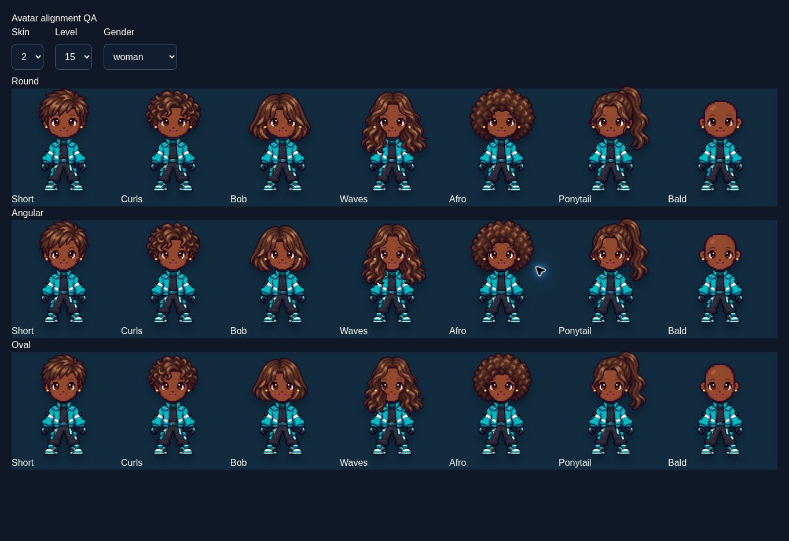

# Dreambound 1.0 RC2 — gameplay and security review

October 26, 2026

## Delivered

Hair now fits the measured visible face width across nine skin/face combinations. Every hair sprite preserves its aspect ratio. Individual forehead anchors lift fringes away from the eyes; the bob no longer uses a stretched, oversized frame. The same renderer serves creator, wardrobe, rewards, and gameplay.

Maya, Jett, and Rio now have distinct authored perspectives across fourteen decision families. Advice responds to affordability, low wellbeing, capped recovery, scholarship eligibility, trust, earlier promises, business changes, work-quest progress, and available alternatives. The panel names the current encounter or age and the previous choice. Exact direct effects are expandable rather than repeating a wall of statistics. Advice is deterministic on refresh and does not change saved state. It is authored game logic, not a live AI model.

Quick Match explanations no longer refer players to an irrelevant checkpoint in the generic situation description. Scoring and existing save compatibility remain under rules version 1.0.

## Validation completed

- Ten complete automated Quick Runs: 150 menus and 2,250 mentor readings; 1,340 distinct rendered advice texts. Text uniqueness is not an engagement score.
- 189 avatar geometry combinations (three skin tones, three faces, seven hair options, three age scales): finite coordinates and preserved hair proportions. Browser visual review covered all seven styles and three faces at tan/child, light/adult, deep/teen feminine, and tan/teen masculine settings. No physical iPhone/Safari validation was performed.
- Ten two-player API Quick Matches: 300 persisted decisions and 40 shared reveals. Also two complete daily runs, recovery/collection checks, unauthorized access rejection, concurrent stale writes, hidden votes, and timer boundaries.
- 150 strategy simulations and 21 daily scenarios repeated with independent players.
- Ten work-goal campaigns; all reached their final personal-quest milestone in 100–116 actions.
- Existing campaign, reward and variety regressions, including 2,000 low-resource menus, passed.
- Browser smoke test: create a solo room, inspect five contextual recommendations, make a choice, observe changed score, next menu, and reward notification. This was not a full browser playthrough or a human study.
- TypeScript passed; dependency peers have no conflicts. Production build is checked during publication.

## Security findings and fixes

This was a source review, dependency audit, targeted local tests, and functional browser check. It was not an independent penetration test, live load test, infrastructure audit, or proof that no vulnerabilities exist.

### Fixed in this release

1. JSON bodies were previously loaded before size validation. The parser now bounds streamed bytes before parsing, including misleading Content-Length values and multibyte input. Invalid JSON, null, arrays, and incorrect content types receive controlled 4xx errors.
2. Room creation, joining, recovery attempts, and recovery-code issuance lacked application throttles. Durable D1 counters now enforce limits across Worker isolates, with a Retry-After response. Counters store time-windowed hashes rather than raw client addresses. Limits depend on the platform's trusted CF-Connecting-IP header; absent addresses share a fallback bucket. Distributed abuse and hosting-level limits still require operational monitoring.
3. Cross-origin writes remain rejected; cross-site Fetch Metadata requests are also rejected. Existing HTTPS cookies retain Secure, HttpOnly, and SameSite=Lax.
4. Added no-sniff, no-referrer, restricted device permissions, and a limited CSP covering object embedding, base URLs, and framing (self and ChatGPT). This is not a nonce-based script CSP and does not constitute a complete XSS defense.
5. Updated affected dependencies, including Next, React/React DOM/server components, Vite, Zod, sharp and audited transitive packages. Peer versions were reconciled and the database generator checked after the esbuild update.

### Dependency audit result

The full dependency audit initially reported 78 advisories: 3 critical, 33 high, 31 moderate and 11 low. After updates it reports **0 critical, 0 high, 2 moderate and 2 low**. Advisory counts do not measure demonstrated exploitability of the deployed game.

All four remaining entries concern fast-uri 3.1.8 (URI scheme/host/path normalization). The prescribed fix is 3.1.9. Installation rejected that version because it had not yet met the repository's seven-day release-age policy. That protection was preserved. Upgrade once eligible and repeat the audit/build. Do not describe this release as vulnerability-free.

Machine-readable final audit: `qa/dependency-audit.json`.

### Authorization checks

Tests verified outsider rejection, opponent-token masking, sealed votes, unauthorized cosmetic rejection, stale/concurrent move protection, recovery hash-only storage, wrong/rotated-code rejection, and private archive isolation. SQL inputs use bound parameters; reviewed user text is rendered through React rather than raw HTML.

Recovery codes are bearer credentials. A lost or shared code can give another person access. Replacing a code does not revoke already-authorized browser seats. Before paid accounts, add proper session management/revocation, ownership restoration, and an independent security assessment.

### Before charging players

- Complete the remaining dependency patch and rerun the audit.
- Add security monitoring, hosting-level abuse protection, cost alerts, and a tested backup/restore procedure. Confirm client-address forwarding and test limits with a classroom-sized shared connection.
- Define retention/deletion and support processes; add secure payment-provider checkout, verified idempotent webhooks, entitlement restoration, and refunds only once the commercial offer is approved.
- Test physical iPhone Safari and Android browsers, sleep/reconnect behavior, and two real devices playing together.
- Do not introduce cash-out, wagering, or cash-prize mechanics into the fictional economy.

## What will make it more compelling

1. Make consequences memorable: a named relationship, an earlier promise returning, and a clear explanation of why an opportunity exists. Favor a few excellent branching scenes over a larger pool of interchangeable questions.
2. Give each run a personal climax: one dream-specific final dilemma and a shareable ending that describes the life built, not just its score.
3. Make friendship central: a shared decision that forces a genuine trade-off between helping the other player and advancing your own goal. Preserve hidden votes and the shared reveal.
4. Make rewards tell a story: link a distinctive cosmetic to a specific achievement, show the remaining steps, and provide immediate equip. Avoid making every action trigger an equally loud celebration.
5. Measure replay behavior with 10–20 new players: independent joining, explanation of winning by decision three, completion, confusing moments, and voluntary return within seven days. Ask what decision they remember. Automated tests cannot establish that people love the game.

Recommendation: continue as a public free release candidate. The core is testable and improved, but remaining security, device, retention, and payment work still prevents an honest claim that it is ready for paid launch or will earn $5,000/month.
